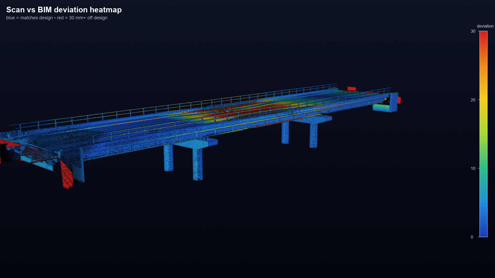
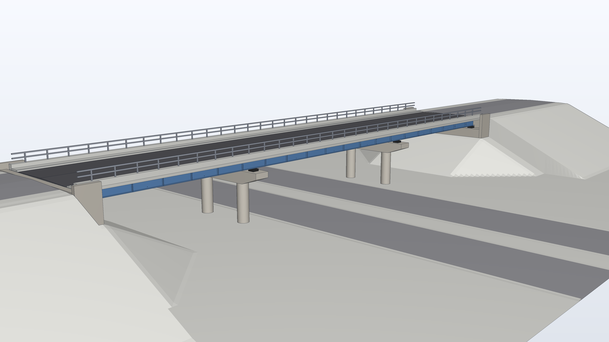
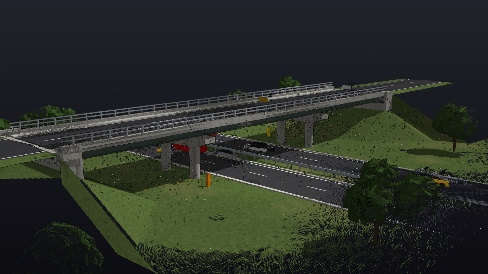
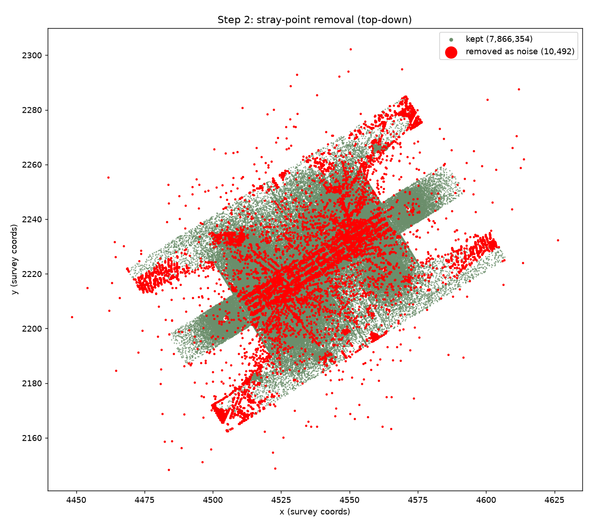
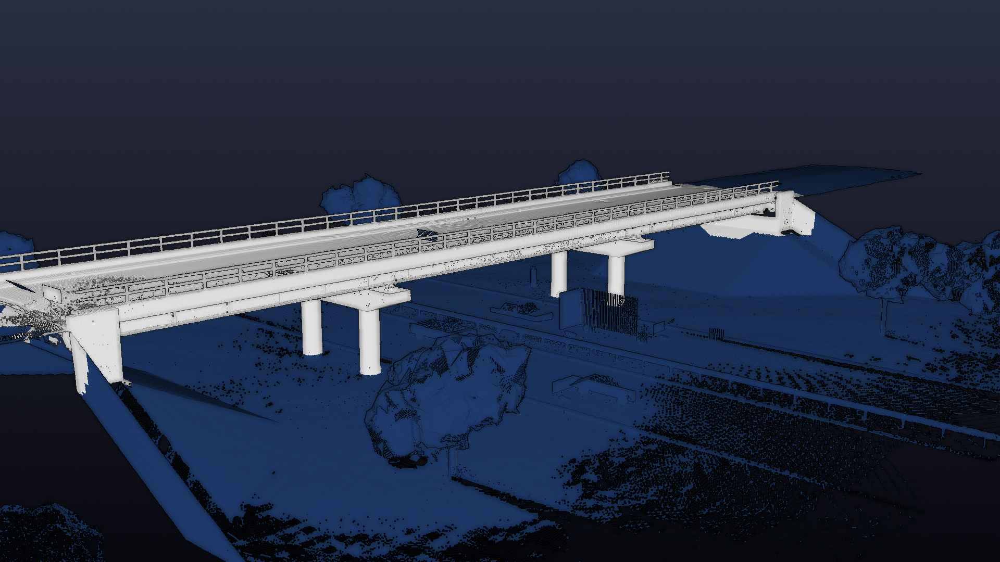
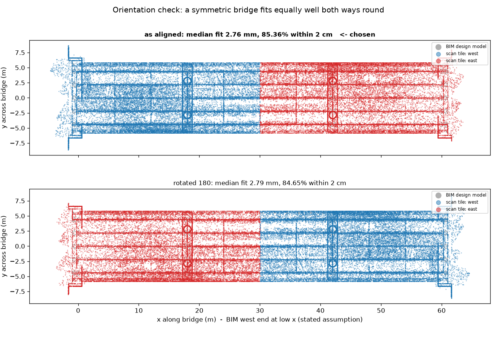
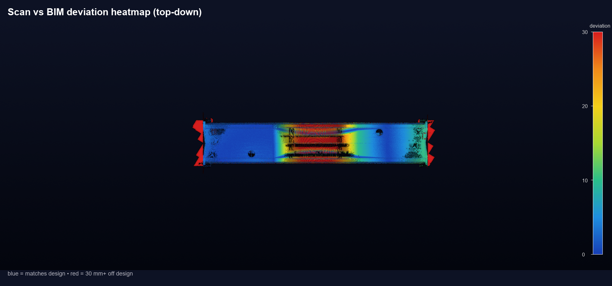
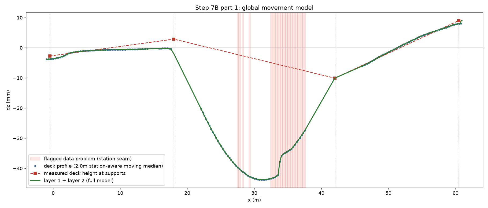
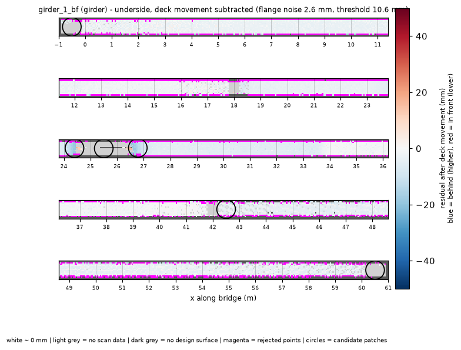
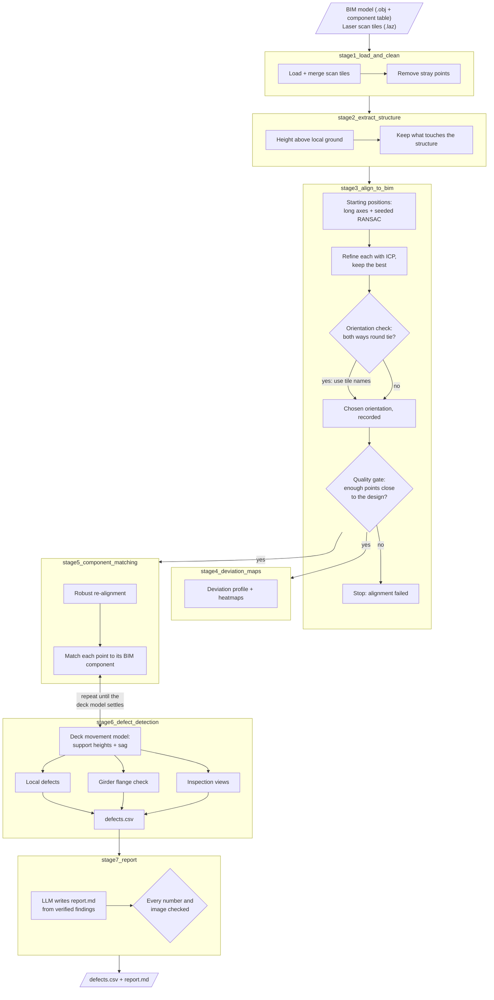

# Bridge inspection: laser scan vs BIM design model

**Finds where a real bridge differs from its design, and by how much, by comparing a 3D laser scan with the
bridge's BIM model.** It separates movement of the whole structure (sag, support settlement, tilt) from
local damage (spalling, bent members), checks every reading against the scan's own measurement noise, and
grades each finding by confidence. One command takes the raw files to a defect list and an inspection report.

On a test bridge with five planted defects it **found all five**, with **no false alarms at high or medium
confidence**, and placed the scan within **3.5 mm** of the true position.



*Every scan point coloured by its distance from the design: blue matches, red is 30 mm or more off.*

---

## Contents

- [The problem](#the-problem)
- [How it works, stage by stage](#how-it-works-stage-by-stage)
- [Flow diagram](#flow-diagram)
- [Results](#results)
- [How to run it](#how-to-run-it)
- [Repository layout](#repository-layout)
- [Lessons learned](#lessons-learned)
- [Limitations and next steps](#limitations-and-next-steps)

---

## The problem

Two descriptions of the same bridge: the **design** (a BIM model, 470 named components such as girders,
piers and abutments) and the **reality** (a laser scan: 7.9 million points from 12 scanner positions,
including traffic, trees, ground and noise). The job is to line them up and find the genuine differences.

| Design model (BIM) | Raw laser scan |
|---|---|
|  |  |

---

## How it works, stage by stage

### Stage 1: Load and clean
Both scan tiles are loaded and merged, and isolated stray points (scanner noise) are removed with
statistical outlier removal: about 10,000 of 7.9 million points.



### Stage 2: Extract the structure
The bridge is separated from ground, vegetation and vehicles **using geometry only**: each point's height
above the local ground, then physical connectivity (only points that touch the main structure are kept).
No trained model is involved. About 2.8 million points remain.



*White: kept as the bridge. Blue: removed (ground, trees, traffic, road below).*

### Stage 3: Align the scan to the design
The scan comes in its own survey coordinates. Several starting positions are tried (the scan's long axis
lined up with the design's, both ways round, plus seeded RANSAC matches of 3D shape features); each is
refined with multi-scale ICP and scored, and the best wins. A single random start can lock onto a wrong
near-match on a structure with repeating piers and spans, so this makes the result reliable and repeatable.
Then an **orientation check** runs: this bridge is symmetric end to end (18/24/18 m spans), so it fits
the design equally well back to front. Both options are tested and, because they tie, the orientation is
taken from external information (the scan tile names "west" and "east") and recorded. A **quality gate**
stops the run if too few points end up close to the design, rather than report defects from a bad alignment.



*The two candidates fit the design equally well (2.79 vs 2.76 mm). Only the tile names show which way round
is right. Without this check every finding would have been placed at its mirror-image position.*

### Stage 4: Deviation maps
The distance from every scan point to the design surface, as a first overview.



### Stage 5: Match every point to its own component
Each scan point is assigned to its named BIM component (e.g. `girder_1_bf`, `pier_1_column_1`) and its
deviation is measured along that component's own surface. Quality checks act on individual points (a
point whose surface direction disagrees with its matched face is set aside, not the whole component).

### Stage 6: Detect defects
**Movement of the whole deck** is modelled first: the deck height at each support and the sag of each span,
measured on the road surface only.



*The main span sags by about 40 mm relative to its supports.*

Members carried by the deck are then compared with the design **plus** that movement, so a local defect
isn't hidden inside the overall sag. What is left is searched for local defects: 25 cm cells, each
component's own noise level, and at least two scanner stations must agree. Every component gets a
straight-on inspection view (-50..+50 mm).

| Girder bottom flange bent up (bridge strike) | Spalling on a pier column | Abutment wall tilting |
|---|---|---|
|  |  |  |
| The bent part (~70 mm) leaves the flange's matching tolerance; a per-metre check catches the missing points. | The column unrolled around its circumference: a ~0.4 m² depression. | Plane fit of the wall: it leans 0.58 deg towards the span. |

### Stage 7: Report
`defects.csv` lists every finding with location, size, scanner stations and confidence. An LLM then writes
`report.md` **from those verified findings only**: it never decides what is a defect, and code checks that
every number and image in its text comes from the source data before the report is saved.

---

## Flow diagram



---

## Results

On a synthetic bridge with five planted defects (scored by a separate evaluation step against the
dataset's answer key):

| Planted defect | Found | Reported | True |
|---|---|---|---|
| Mid-span sag, span 2 | yes (high confidence) | 39.8 mm | 35 mm |
| Pier 2 settlement | yes (medium) | "appears lower by 10-16 mm; needs control points to confirm" | 18 mm |
| Spalling, pier 1 column 1 | yes (high) | 18.5 mm | up to 45 mm |
| Bridge strike, girder 1 bottom flange | yes (high) | 69.8 mm | 70 mm |
| Abutment 2 rotated towards the span | yes (high) | 0.58 deg | 0.55 deg |

- **False alarms:** none at high or medium confidence; 57 at low confidence, mostly edge effects.
- **Alignment:** 3.5 mm median error against the true scan-to-BIM transform.
- **Runtime:** about 26 minutes on a laptop.

Full results of one run: [example_results/](example_results) — the report, `defects.csv`, the scorecard and
all inspection views.

---

## How to run it

**1. Get the code and install** (Python 3.13):

```bash
git clone https://github.com/Quadribakare/bridge-scan-bim-inspection.git
cd bridge-scan-bim-inspection
python -m venv .venv
# Windows:      .venv\Scripts\activate
# macOS/Linux:  source .venv/bin/activate
pip install -r requirements.txt
```

**2. Add the data** (not included in the repository):

```
data/
├── bim/
│   ├── bridge_BIM.obj                 # the design model
│   └── bridge_BIM_components.csv      # its component table (must be named <model>_components.csv)
└── scan/
    ├── bridge_scan_west.laz           # scan tiles; "west"/"east" in the names fixes the orientation
    └── bridge_scan_east.laz
```

**3. Add an OpenRouter API key** for the report step: create a file called `.env` in the project folder
containing `OPENROUTER_API_KEY=your-key`. It is git-ignored. Each report costs about $0.04.

**4. Run:**

```bash
python run_pipeline.py --bim data/bim/bridge_BIM.obj \
    --scan data/scan/bridge_scan_west.laz data/scan/bridge_scan_east.laz \
    --out outputs
```

The terminal shows each step as it runs (full output of one run:
[example_results/terminal_output.txt](example_results/terminal_output.txt)):

```
1-3  load, clean, extract the structure
  step1_load                      ok  (61 s)
  step2_clean                     ok  (69 s)
  ...
4    align (coarse + ICP) and orientation ambiguity check
  step4_align                     ok  (229 s)
  ...
7A/7B component matching <-> deck movement model, until the model settles
       iteration 3: deck movement model changed by 0.05 mm
  ...
10   report
  step10_report                   ok  (39 s)

done in 25.9 min -> outputs/defects.csv, outputs/report.md
eport.md
```

**Options:**

| Option | What it does |
|---|---|
| `--report-only` | rewrite only `report.md` from an existing run (under a minute instead of the full run) |
| `--answer-key <folder>` | also score the result against an answer key (writes `scorecard.md`); the pipeline itself never reads it |

**What you get** in the output folder: `report.md` (the inspection report), `defects.csv` (every finding),
`inspection_views/` (one deviation map per component, plus contact sheets), heatmaps, the deck profile,
and `logs/` (one log per step). All thresholds are in [`config.yaml`](config.yaml), each with the reasoning;
none is tuned to this particular bridge.

---

## Repository layout

```
bridge-scan-bim-inspection/
├── run_pipeline.py                  # the single command that runs everything
├── config.yaml                      # every threshold and setting, with the reasoning
├── requirements.txt
├── pipeline/
│   ├── common/                      # where inputs are read from and outputs written to
│   ├── stage1_load_and_clean/       # load scan tiles + BIM, remove stray points
│   ├── stage2_extract_structure/    # separate the bridge from ground, trees and traffic
│   ├── stage3_align_to_bim/         # alignment (several starts + ICP), orientation check, quality gate
│   ├── stage4_deviation_maps/       # deviation profile and heatmaps
│   ├── stage5_component_matching/   # match every point to its own BIM component
│   ├── stage6_defect_detection/     # deck movement, local defects, girder flanges, views, defects.csv
│   ├── stage7_report/               # LLM-written report with automatic fact checks
│   └── evaluation/                  # optional scoring against an answer key
├── example_results/                 # the output of one full run (report, defects, scorecard, views)
└── docs/images/                     # images used in this README
```

---

## Lessons learned

- **A symmetric bridge can be aligned back to front.** The first alignment was exactly 180 deg out. Fit
  quality cannot tell the two orientations apart, so the pipeline now checks both and uses external
  information to choose.
- **A single random alignment start is not reliable.** On a bridge with repeating piers and spans, one
  RANSAC run once left a quarter of the bridge metres off. The alignment now tries several starts, keeps the
  best, and a quality gate stops the run rather than report defects from a bad alignment.
- **Mixing surfaces fakes noise.** Treating every upward-facing point as "deck" (road, footways, kerbs, girder
  flanges together) made scanner stations appear to disagree by 34.5 mm. On the road surface alone, without the
  lowest centimetres of a vehicle standing on the deck, it was 1.2 mm.
- **Quality filters can delete real damage.** Early checks removed whole piers and abutments from the
  assessment. Checks now act on individual points, and rejected points are kept as possible rough surfaces.
- **Movement of the whole deck can hide local damage.** A 40 mm sag pushed a thin girder flange outside its
  matching tolerance and hid the bridge strike, until deck-carried members were matched against the design
  plus the measured movement.
- **AI image review was tested and not adopted for finding defects.** Two vision models reviewed 308
  inspection views; they rarely agreed with each other and both dismissed the bridge strike as an occlusion.
  Defects are found by measurement; the LLM only writes the report.

## Limitations and next steps

- **Synthetic data, one bridge.** The next test is to run the pipeline, unchanged, on an unseen second bridge.
- **Developed with partial knowledge of the answers.** The answer key was opened during an earlier
  development session; the final defect list was frozen before scoring, but only an unseen bridge gives a
  clean result.
- **Support movement needs surveyed control points** to be confirmed; without them it is reported as a range.
- **Orientation relies on the tile names** and the stated assumption that the BIM's +x runs west to east.
- **Small, deep defects are under-sized**, because depths are reported as 25 cm cell medians.
