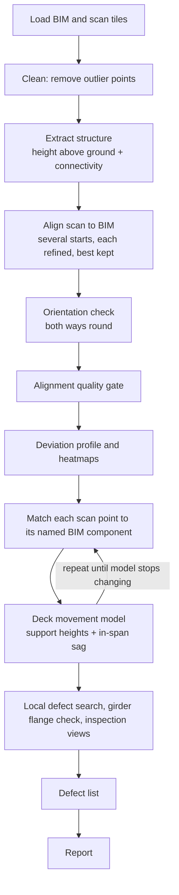
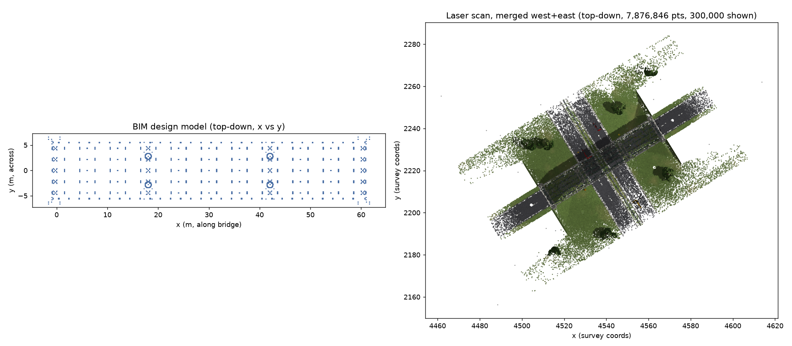
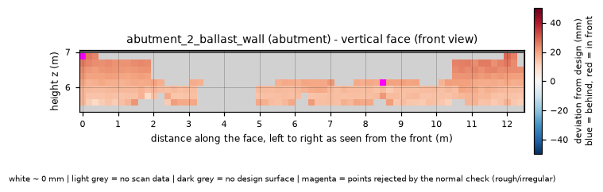
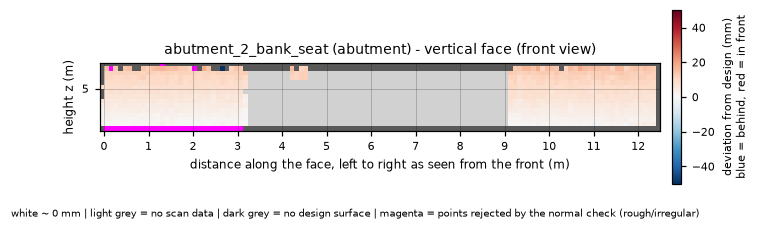
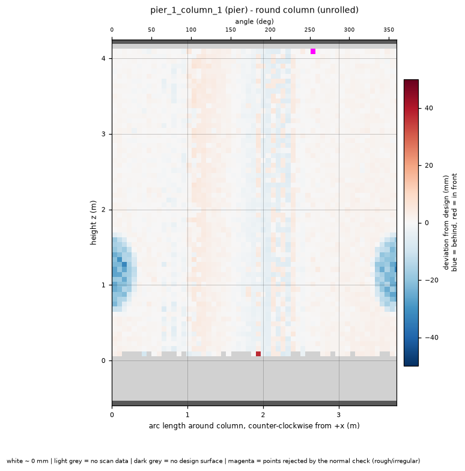

# Bridge Inspection Report: Laser Scan Compared with the Design Model

## What the system does

The system compares a laser scan of the bridge with its design model (BIM) and reports where the built structure differs from the design. Every finding is checked by measurement. An AI model is used only to write this report from the verified findings.

**Inputs**
- Design model: `bridge_BIM.obj`.
- Scan tiles: `bridge_scan_west.laz` and `bridge_scan_east.laz`.
- The scan has 7,876,846 points from 12 scanner stations. 2,796,305 points were kept as the structure.
- The model has 470 components. 438 received scan points and 392 had enough data to be assessed.

**Orientation check.** The bridge is symmetric, so the scan fits the design almost equally well either way round. The median distance to the design was 2.76 mm as aligned and 2.79 mm when rotated 180 degrees, which is a tie. The orientation "as aligned" was chosen using the scan tile names (west/east) and an **assumption** that BIM +x runs west to east. This rests on metadata, not on the measurements.

## Pipeline



## Findings

There are 66 findings: 5 high, 1 medium and 60 low confidence. Coordinates are in metres: x along the bridge, y across, z height. Deviations are signed.

| ID | Component | Finding | Location (x, y, z) | Size | Stations | Confidence |
|---|---|---|---|---|---|---|
| D001 | deck span 18-42 m | In-span sag relative to its own supports | 30.05, 0.0, – | -39.8 mm | 2 | high |
| D002 | abutment_2_ballast_wall | Wall tilt: lean -0.58 deg, top displaced +14.3 mm (+ = outward), over a 12.3 x 1.4 m face | 61.3, 0.0, 6.18 | 17.28 m², 14.3 mm | 7 | high |
| D003 | abutment_2_bank_seat | Wall tilt: lean -0.56 deg, top displaced +12.3 mm (+ = outward), over a 12.4 x 1.2 m face | 60.5, 0.0, 4.8 | 15.5 m², 12.3 mm | 7 | high |
| D004 | girder_1_bf | Local flange deviation (higher than deck movement); flange deformed beyond its matching margin, surface +70 mm from expected | 25.56, -4.39, 5.7 | 1.125 m², 69.8 mm | 7 | high |
| D005 | pier_1_column_1 | Local deviation (vertical surface) | 18.55, -2.81, 1.13 | 0.188 m², 18.5 mm | 5 | high |
| D006 | pier_2 | Support movement: pier_2 appears lower by 10-16 mm; needs control points to confirm | 42.0, 0.0, – | -10.1 mm | 9 | medium |

**Low-confidence items (60), by type**

| Type | Count |
|---|---|
| Rough/irregular surface at a sharp BIM edge | 37 |
| Points rejected at a flange end or fitting | 15 |
| Small local deviation | 7 |
| Small wall tilt | 1 |

The full list is in `defects.csv`.

## Global movement

**Deck sag.** Only the 18-42 m span shows a confirmed sag. It is deepest at -39.8 mm at x = 30.05 m, against a threshold of 3.5 mm. No other span was confirmed.

| Span (m) | Deepest (mm) | At x (m) | Confirmed |
|---|---|---|---|
| -1.95 to -0.5 | -1.1 | -0.95 | no |
| -0.5 to 18.0 | -3.1 | 17.55 | no |
| 18.0 to 42.0 | -39.8 | 30.05 | **yes** |
| 42.0 to 60.5 | -0.9 | 60.3 | no |
| 60.5 to 61.97 | -1.1 | 60.55 | no |

**Support movement.** pier_2 appears lower by 10-16 mm. This **needs control points to confirm**. The survey had no stable external reference, so the levelling had to be anchored to part of the structure itself. A pier is reported only when both reference choices agree on direction and both exceed 5 mm. The magnitude is given as the range between them: -10.1 mm and -15.5 mm for pier_2.

A residual alignment tilt of about 0.013 degrees (about 7 mm end to end) cannot be told apart from settlement.

- pier_1: inconclusive, because the result depends on the reference choice (2.9 mm and 2.0 mm).
- abutment_1: -2.7 mm and 0.0 mm under the two references.
- abutment_2: 9.0 mm and 0.0 mm under the two references.
- End-span slopes: 0.3 mm/m (abutment_1 to pier_1) and 1.03 mm/m (pier_2 to abutment_2).

The next step is to use surveyed control points on stable ground.

## Key images



Design model (left) and raw laser scan (right), top-down.


The extracted structure, with ground, vegetation and vehicles removed.


3D heatmap of the distance from each scan point to the design.


The same deviation heatmap, top-down.


Deck profile along the bridge with measured deck heights at the supports; shaded bands show where stations disagree more than usual.



Finding D002, abutment_2_ballast_wall, straight-on, -50 to +50 mm (blue = behind design, red = in front, white about 0, light grey = no scan data, dark grey = no design surface, magenta = points rejected as irregular).



Finding D003, abutment_2_bank_seat, same colour scale.


Finding D004, girder_1_bf, same colour scale, with deck movement removed.



Finding D005, pier_1_column_1, same colour scale.

**Contact sheets (all components at a glance)**
- [Abutment](inspection_views/contact_sheet_abutment.png)
- [Bearing](inspection_views/contact_sheet_bearing.png)
- [Crossframe](inspection_views/contact_sheet_crossframe.png)
- [Deck](inspection_views/contact_sheet_deck.png)
- [Girder](inspection_views/contact_sheet_girder.png)
- [Girder bottom flanges (residual)](inspection_views/contact_sheet_girder_bottom_flanges_residual.png)
- [Girder small parts](inspection_views/contact_sheet_girder_small_parts.png)
- [Parapet](inspection_views/contact_sheet_parapet.png)
- [Pier](inspection_views/contact_sheet_pier.png)
- [Railing](inspection_views/contact_sheet_railing.png)
- [Railing small parts](inspection_views/contact_sheet_railing_small_parts.png)
- [Surfacing](inspection_views/contact_sheet_surfacing.png)

## Lessons learned

1. **A symmetric bridge can be aligned back to front.** With matching 18/24/18 m spans, the scan fits equally well after a 180-degree turn (2.79 vs 2.76 mm median). The first alignment was exactly 180 degrees out, which would have put every defect at the mirror-image position. The pipeline now tests both options. When they tie, it requires external information (tile names, control points or georeferencing) and records which was used.
2. **Mixing surfaces fakes noise.** Treating every upward-facing point as "deck" mixed the road with footways, kerbs and girder flanges. This looked like 34.5 mm of disagreement between stations. On the road surface alone it was about 9 mm, and about 1.2 mm once the bottom few centimetres of a vehicle on the deck were filtered out. Girder-underside noise looked like 16 mm instead of 2-3 mm per flange. An implausible noise figure is a bug in the method, not a property of the scanner.
3. **Quality filters can delete the damage they should find.** Early checks switched off whole components, such as round columns and flat surfaces, and removed piers and abutments from the assessment. Checks now act on individual points. Points rejected as irregular are kept, drawn in magenta and searched as possible rough or broken surfaces.
4. **Movement of the whole deck can hide local damage.** A 4 cm girder flange gets a matching tolerance of about 2 cm. Where the deck sags 40 mm, 95-99% of its scan points fell outside that tolerance. The real 70 mm bridge-strike deformation was invisible. Members carried by the deck are now matched against the design plus the measured deck movement, and a per-metre check reports where points go missing.
5. **AI image review was tested and not adopted for finding defects.** Two vision models reviewed 308 inspection views ($8.74). They agreed with each other on 2 of 20 defect calls and added nothing significant. Both dismissed the girder strike as an occlusion, because in the image it appears as missing data. Defects are found by measurement.
6. **A single random alignment start is not reliable.** A bridge with repeating piers and spans has many near-matches. In one run a single start left about a quarter of the bridge metres away from the design. The alignment now tries several starting positions and keeps the best. A quality gate stops the run if too few points end up close to the design.

## Limitations and next steps

- **Synthetic data, one bridge.** Real scans add wet or reflective surfaces, dense vegetation and larger registration errors.
- **Development had partial knowledge of the answers.** The answer key was opened during an earlier development session, so some design choices were made knowing which defects existed. For the final scoring, `defects.csv` was frozen before the answer key was read. The scoring rules were only made stricter after the first scoring run. The real test is to run the pipeline, unchanged, on an unseen second bridge.
- **Support movement needs surveyed control points on stable ground.** Without them it is reported as a range with the caveat given above.
- **Orientation relies on metadata.** For this symmetric structure it comes from the tile names and the assumption that BIM +x runs west to east. Georeferencing would remove that assumption.
- **Small, deep defects are under-sized.** Depths are reported as 25 cm cell medians, which averages away the deepest point of a small spall. Reporting the peak depth is a next step.
- **Low-confidence clutter.** Most low-confidence items are edge effects. They could be hidden by default.
- **Cost guard for any AI calls:** one model, a hard per-run spending cap, cached responses, and a spending limit on the API key.

## Reproduce

```
python run_pipeline.py --bim <bim.obj> --scan <tile1.laz> <tile2.laz> --out <folder>

---
*Report text written by `anthropic/claude-sonnet-5.5` from this run's verified findings; every number and image in it was checked automatically against the source data. Defects are found by measurement, not by the AI.*

## Scorecard (computed against the answer key; not written by the AI)

Findings scored: `defects.csv` (66 rows). Answer key: 5 defects (2 structure-wide, 3 local).

Matching: a local finding matches a local defect only if it is on one of the defect's labelled components AND within 2.0 m of its labelled points. A global finding (sag, support movement) matches a structure-wide defect if it is within 2.0 m of the defect's centre along the bridge. Locations come from the answer key's own labels and scan-to-BIM transform, not from this pipeline's alignment.

### Per defect

| # | True defect | Found? | Matched finding(s) | Reported | True | Size error |
|---|---|---|---|---|---|---|
| 1 | Mid-span sag in span 2 (35 mm at centre) | **found** | D001 (high) | 39.8 mm | 35 mm | +4.8 mm (+14%) |
| 2 | Pier 2 settlement (18 mm), deck above follows | **found** | D006 (medium) | 10-16 mm | 18 mm | range -8 to -2 mm |
| 3 | Spalling with exposed rebar, pier 1 column 1 splash zone (up to 45 mm deep) | **found** | D005 (high) | 18.5 mm | 45 mm | -26.5 mm (-59%) |
| 4 | Bridge strike: girder 1 bottom flange bent up (up to 70 mm) over carriageway A | **found** | D004 (high) | 69.8 mm | 70 mm | -0.2 mm (-0%) |
| 5 | Abutment 2 bank seat + ballast wall rotated towards span (0.55 deg, ~26 mm at top) | **found** | D002 (high), D003 (high), D012 (low), D013 (low), D014 (low) | 14.3 mm, 0.58 deg | 26 mm, 0.55 deg | -11.7 mm (-45%); angle +0.03 deg |

### Summary

- **Found 5 of 5** true defects.
- Findings matching a true defect: 9 of 66.
- **False alarms: 57** - by confidence: high 0, medium 0, low 57.
- High + medium confidence findings: 6, of which 6 match a true defect.

### False alarms

| id | component | finding | size (mm) | stations | confidence |
|---|---|---|---|---|---|
| D007 | abutment_1_ballast_wall | wall tilt: lean +0.21 deg, top displaced -5.2 mm (+ = outward) over a 12.4 x 1.4 m face | -5.2 | 8 | low |
| D008 | abutment_1_ballast_wall | rough/irregular surface at a sharp BIM edge | 78.4 | 2 | low |
| D009 | abutment_1_ballast_wall | rough/irregular surface at a sharp BIM edge | 53.8 | 2 | low |
| D010 | abutment_1_return_wall_N | rough/irregular surface at a sharp BIM edge | 92.9 | 3 | low |
| D011 | abutment_1_return_wall_S | rough/irregular surface at a sharp BIM edge | 85.6 | 3 | low |
| D015 | abutment_2_return_wall_N | rough/irregular surface at a sharp BIM edge | 98.9 | 5 | low |
| D016 | abutment_2_return_wall_N | rough/irregular surface at a sharp BIM edge | 84.5 | 3 | low |
| D017 | abutment_2_return_wall_S | rough/irregular surface at a sharp BIM edge | 82.9 | 3 | low |
| D018 | crossframe_019 | rough/irregular surface at a sharp BIM edge | 3.1 | 3 | low |
| D019 | crossframe_022 | rough/irregular surface at a sharp BIM edge | 1.3 | 2 | low |
| D020 | crossframe_026 | rough/irregular surface at a sharp BIM edge | 2.0 | 3 | low |
| D021 | crossframe_030 | rough/irregular surface at a sharp BIM edge | 1.9 | 2 | low |
| D022 | crossframe_037 | rough/irregular surface at a sharp BIM edge | 2.9 | 2 | low |
| D023 | crossframe_041 | rough/irregular surface at a sharp BIM edge | 2.4 | 2 | low |
| D024 | crossframe_046 | rough/irregular surface at a sharp BIM edge | 5.4 | 3 | low |
| D025 | crossframe_055 | rough/irregular surface at a sharp BIM edge | 1.8 | 3 | low |
| D026 | crossframe_063 | rough/irregular surface at a sharp BIM edge | 5.6 | 3 | low |
| D027 | crossframe_086 | rough/irregular surface at a sharp BIM edge | 0.8 | 2 | low |
| D028 | edge_upstand_N | rough/irregular surface at a sharp BIM edge | 94.0 | 3 | low |
| D029 | girder_1_bf | points rejected at flange end / fitting | -12.0 | 6 | low |
| D030 | girder_1_bf | points rejected at flange end / fitting | 27.1 | 5 | low |
| D031 | girder_1_bf | points rejected at flange end / fitting | -7.5 | 6 | low |
| D032 | girder_1_tf | rough/irregular surface at a sharp BIM edge | 5.1 | 2 | low |
| D033 | girder_2_bf | rough/irregular surface at a sharp BIM edge | 5.5 | 2 | low |
| D034 | girder_2_bf | rough/irregular surface at a sharp BIM edge; points rejected at flange end / fitting | 5.0 | 6 | low |
| D035 | girder_2_bf | rough/irregular surface at a sharp BIM edge | 3.4 | 2 | low |
| D036 | girder_2_bf | rough/irregular surface at a sharp BIM edge | 1.9 | 4 | low |
| D037 | girder_2_bf | rough/irregular surface at a sharp BIM edge | 1.9 | 4 | low |
| D038 | girder_2_bf | points rejected at flange end / fitting | 1.9 | 7 | low |
| D039 | girder_2_bf | points rejected at flange end / fitting | 25.2 | 5 | low |
| D040 | girder_2_bf | points rejected at flange end / fitting | 25.4 | 3 | low |
| D041 | girder_2_bf | points rejected at flange end / fitting | -8.3 | 6 | low |
| D042 | girder_3_bf | rough/irregular surface at a sharp BIM edge | 1.7 | 2 | low |
| D043 | girder_3_bf | local flange deviation (higher than deck movement) | 16.4 | 2 | low |
| D044 | girder_3_bf | local flange deviation (higher than deck movement) | 11.0 | 2 | low |
| D045 | girder_3_bf | local flange deviation (higher than deck movement) | 11.4 | 2 | low |
| D046 | girder_3_bf | points rejected at flange end / fitting | 2.5 | 7 | low |
| D047 | girder_3_bf | points rejected at flange end / fitting | 24.4 | 6 | low |
| D048 | girder_3_bf | points rejected at flange end / fitting | 2.0 | 7 | low |
| D049 | girder_4_bf | rough/irregular surface at a sharp BIM edge | 8.3 | 3 | low |
| D050 | girder_4_bf | rough/irregular surface at a sharp BIM edge | 5.6 | 2 | low |
| D051 | girder_4_bf | rough/irregular surface at a sharp BIM edge | 5.0 | 3 | low |
| D052 | girder_4_bf | rough/irregular surface at a sharp BIM edge | 4.8 | 2 | low |
| D053 | girder_4_bf | points rejected at flange end / fitting | 4.7 | 6 | low |
| D054 | girder_4_bf | points rejected at flange end / fitting | -1.8 | 4 | low |
| D055 | girder_5_bf | points rejected at flange end / fitting | -0.0 | 7 | low |
| D056 | girder_5_bf | points rejected at flange end / fitting | 15.0 | 7 | low |
| D057 | girder_5_bf | points rejected at flange end / fitting | -9.0 | 6 | low |
| D058 | kerb_S | rough/irregular surface at a sharp BIM edge | 2.0 | 2 | low |
| D059 | parapet_post_N_022 | local deviation (vertical surface) | 12.1 | 3 | low |
| D060 | parapet_post_N_025 | rough/irregular surface at a sharp BIM edge; local deviation (underside surface) | 27.5 | 2 | low |
| D061 | parapet_post_N_026 | rough/irregular surface at a sharp BIM edge | 23.7 | 2 | low |
| D062 | parapet_post_N_027 | rough/irregular surface at a sharp BIM edge | 19.1 | 3 | low |
| D063 | parapet_post_N_028 | local deviation (underside surface) | 28.8 | 2 | low |
| D064 | parapet_post_S_028 | local deviation (underside surface) | 22.0 | 2 | low |
| D065 | parapet_rail_N_002 | rough/irregular surface at a sharp BIM edge | 36.9 | 3 | low |
| D066 | parapet_rail_S_002 | rough/irregular surface at a sharp BIM edge | 35.8 | 3 | low |

### Where each true defect is (from the answer key labels, BIM coordinates)

- Defect 1: 745,348 labelled points, components crossframe, deck_slab, diaphragm, edge_upstand_N, edge_upstand_S, footway_N, footway_S, girder_1_bf, girder_1_stiff, girder_1_tf, girder_1_web, girder_2_bf, girder_2_stiff, girder_2_tf, girder_2_web, girder_3_bf, girder_3_stiff, girder_3_tf, girder_3_web, girder_4_bf, girder_4_stiff, girder_4_tf, girder_4_web, girder_5_bf, girder_5_stiff, girder_5_tf, girder_5_web, kerb_N, kerb_S, parapet_post_N, parapet_post_S, parapet_rail_N, parapet_rail_S, surfacing_L, surfacing_R, x 19.0 to 41.5 m, y -5.8 to 5.8 m, z 5.7 to 8.2 m
- Defect 2: 560,235 labelled points, components bearing_s2, crossframe, deck_slab, diaphragm, edge_upstand_N, edge_upstand_S, footway_N, footway_S, girder_1_bf, girder_1_stiff, girder_1_tf, girder_1_web, girder_2_bf, girder_2_stiff, girder_2_tf, girder_2_web, girder_3_bf, girder_3_stiff, girder_3_tf, girder_3_web, girder_4_bf, girder_4_stiff, girder_4_tf, girder_4_web, girder_5_bf, girder_5_stiff, girder_5_tf, girder_5_web, kerb_N, kerb_S, parapet_post_N, parapet_post_S, parapet_rail_N, parapet_rail_S, pier_2_column_1, pier_2_column_2, pier_2_crosshead, plinth_s2, surfacing_L, surfacing_R, x 41.2 to 56.0 m, y -5.8 to 5.8 m, z 1.1 to 8.2 m
- Defect 3: 1,109 labelled points, components pier_1_column_1, x 18.5 to 18.6 m, y -3.1 to -2.5 m, z 0.6 to 1.7 m
- Defect 4: 5,559 labelled points, components girder_1_bf, girder_1_web, x 24.1 to 26.9 m, y -4.6 to -4.1 m, z 5.7 to 6.2 m
- Defect 5: 19,951 labelled points, components abutment_2_ballast_wall, abutment_2_bank_seat, x 59.4 to 61.6 m, y -6.0 to 6.0 m, z 4.6 to 6.9 m

### Alignment error vs the true scan-to-BIM transform

Same physical points (the 2.8M extracted bridge points), placed in BIM coordinates by the answer key's transform and by this pipeline. Error = pipeline position minus true position.

| stage | median error | p95 | max | mean offset x / y / z (mm) | rotation error | at bridge ends (x<2 / x>58 m) |
|---|---|---|---|---|---|---|
| step 4 alignment | 3.7 mm | 10.3 mm | 11.8 mm | -1.2 / +0.4 / +3.8 | 0.0124 deg | 2.3 / 10.8 mm |
| after orientation check (4b) | 3.6 mm | 9.6 mm | 11.4 mm | -1.7 / +0.4 / +3.4 | 0.0133 deg | 2.8 / 10.1 mm |
| final (7A robust re-alignment) | 3.5 mm | 9.4 mm | 11.2 mm | -1.7 / +0.4 / +3.3 | 0.0133 deg | 2.8 / 9.9 mm |

(For scale: answer-key per-station registration error is "range noise ~1 mm + 25 ppm, worse at grazing angles; per-station registration error ~2.5 mm / 0.004 deg".)

